# Stage 2 AI workflows — separate retrieval and validation branches

Both views use AgentController. Each task retrieves its own saved inputs and
validates generated output before persistence. Skill and requirement changes use
numbered approvals; generated documents require candidate review before saving.
The diagrams follow the implemented feature-specific services and validation branches.

## F03 — Resume skill extraction

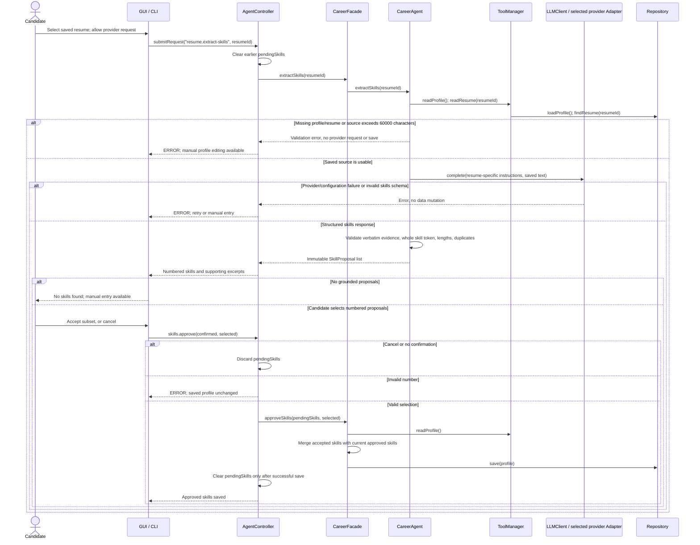

## F05 — Job description analysis

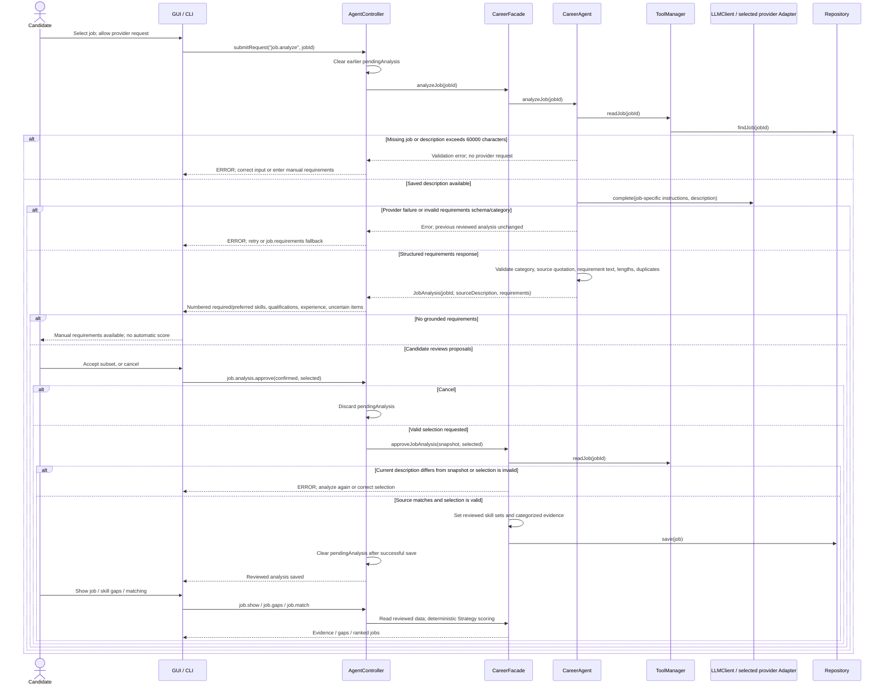

Changing the stored description clears old analysis. Education, experience and
uncertain requirements remain visible with evidence but are not scored as skills.
The sections below expand F06–F13/F16/F17 with feature-specific retrieval and validation.

# Additional feature-specific branches

Each task below retrieves its own inputs and validates its own output schema. Shared
HTTP/JSON/evidence helpers do not replace these branches. AI responses are data;
no response is executed as a dynamic tool command.

F10/F11/F13/F16/F17 use a shared bounded response helper: invalid generated content
permits one corrective request with the validation reason. Provider/configuration
errors return immediately. Each feature retains the retrieval and validation
operations shown below; older saved records remain compatible.

## F06 — Skill gap explanation

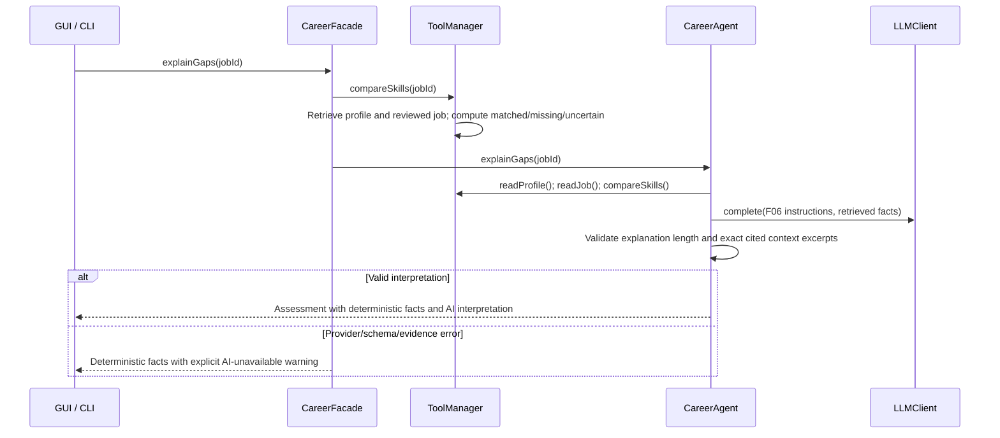

## F07 — Matching explanation

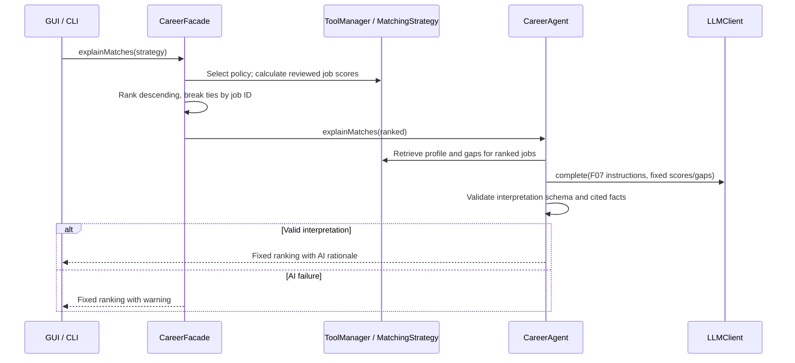

## F08 — Selected-job comparison

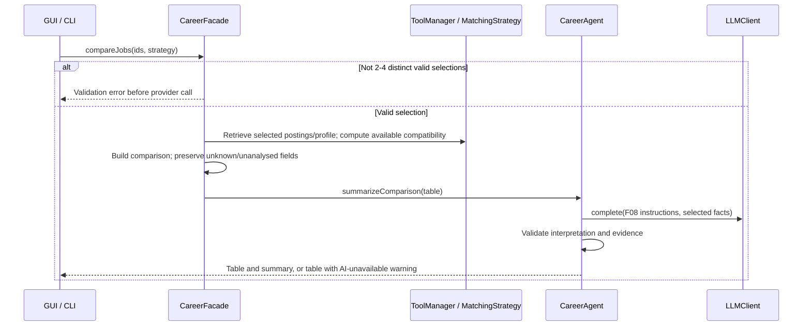

## F09 — Customized resume suggestions

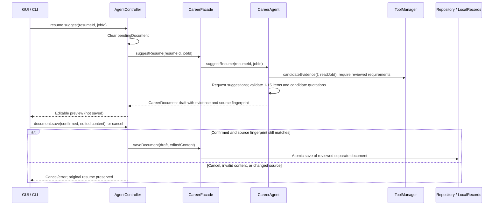

## F10 — Cover letter drafting

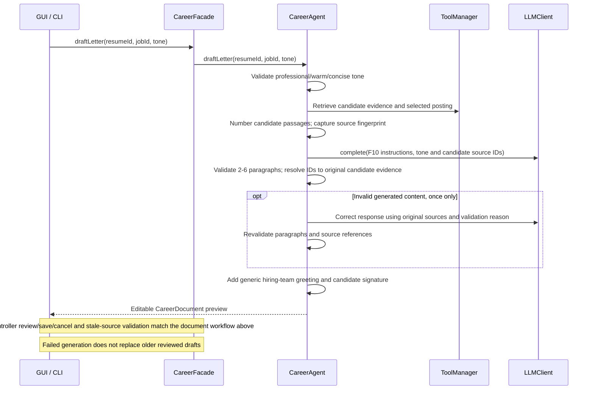

## F11 — Interview question generation

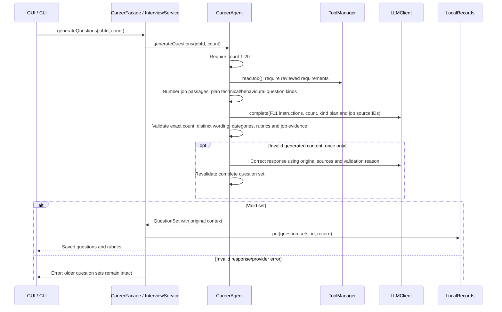

## F12 — Persistent mock interview

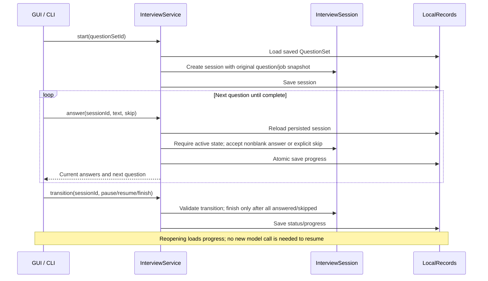

## F13 — Interview answer feedback

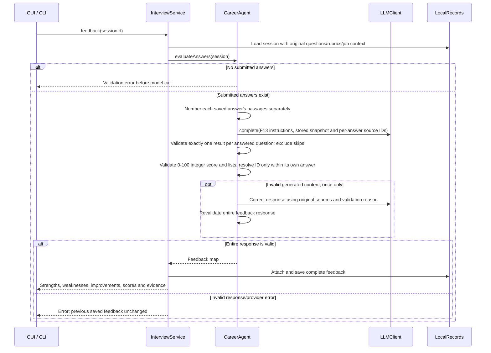

## F16 — Source-cited company notes

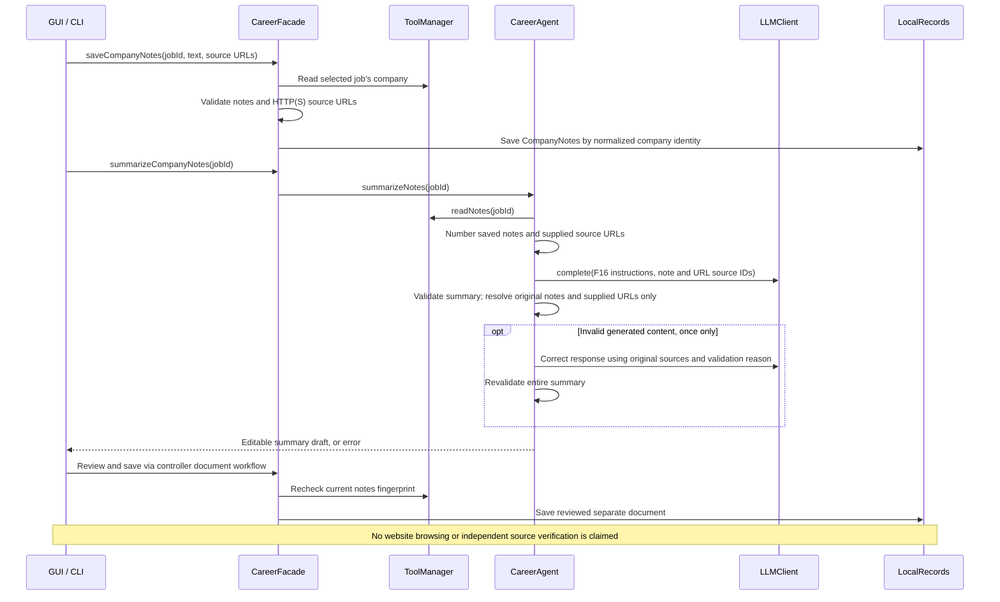

## F17 — Career plan within time and cost limits

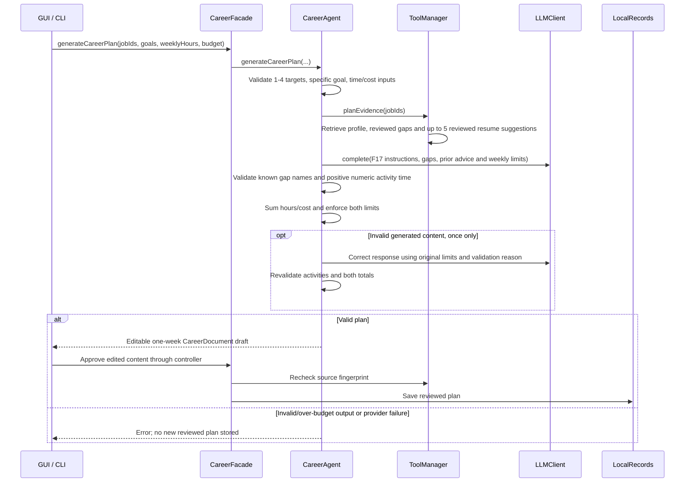

## Provider configuration (Groq Free-plan default / optional OpenAI)

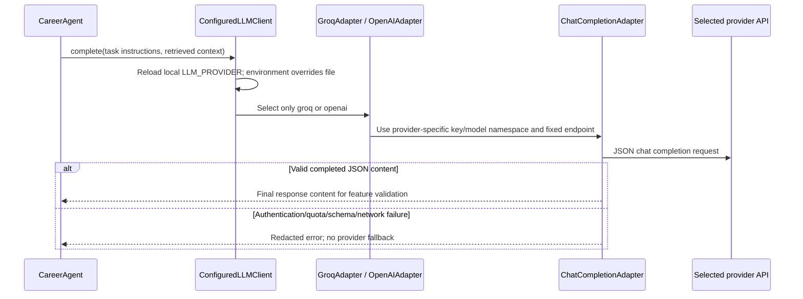

Groq defaults to `openai/gpt-oss-20b`; free-plan quotas require paced requests and
short demonstration inputs. The OpenAI model identifier here refers to an
open-weight model hosted by Groq, not an OpenAI API billing requirement. The chosen
provider's private key is stored locally. Feature-specific schema/evidence checks
are unchanged. Provider setup and all seventeen feature demonstration links are
documented in [README.md](../README.md).
