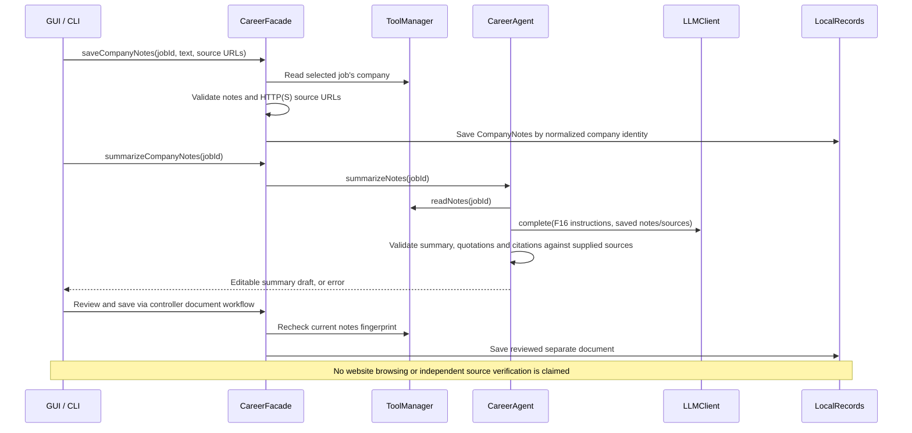

# Stage 2 AI workflows — separate retrieval and validation branches

Both views use AgentController. No generated output writes data until the candidate
selects numbered proposals and confirms. These are implemented bounded tasks, not
a generic loop standing in for unimplemented AI features.

## F03 — Resume skill extraction

```mermaid
sequenceDiagram
    actor Candidate
    participant View as GUI / CLI
    participant Controller as AgentController
    participant Facade as CareerFacade
    participant Agent as CareerAgent
    participant Tools as ToolManager
    participant LLM as LLMClient / selected provider Adapter
    participant Store as Repository
    Candidate->>View: Select saved resume; allow provider request
    View->>Controller: submitRequest("resume.extract-skills", resumeId)
    Controller->>Controller: Clear earlier pendingSkills
    Controller->>Facade: extractSkills(resumeId)
    Facade->>Agent: extractSkills(resumeId)
    Agent->>Tools: readProfile(); readResume(resumeId)
    Tools->>Store: loadProfile(); findResume(resumeId)
    alt Missing profile/resume or source exceeds 60000 characters
        Agent-->>Controller: Validation error, no provider request or save
        Controller-->>View: ERROR; manual profile editing available
    else Saved source is usable
        Agent->>LLM: complete(resume-specific instructions, saved text)
        alt Provider/configuration failure or invalid skills schema
            LLM-->>Controller: Error, no data mutation
            Controller-->>View: ERROR; retry or manual entry
        else Structured skills response
            Agent->>Agent: Validate verbatim evidence, whole skill token, lengths, duplicates
            Agent-->>Controller: Immutable SkillProposal list
            Controller-->>View: Numbered skills and supporting excerpts
            alt No grounded proposals
                View-->>Candidate: No skills found; manual entry available
            else Candidate selects numbered proposals
                Candidate->>View: Accept subset, or cancel
                View->>Controller: skills.approve(confirmed, selected)
                alt Cancel or no confirmation
                    Controller->>Controller: Discard pendingSkills
                else Invalid number
                    Controller-->>View: ERROR; saved profile unchanged
                else Valid selection
                    Controller->>Facade: approveSkills(pendingSkills, selected)
                    Facade->>Tools: readProfile()
                    Facade->>Facade: Merge accepted skills with current approved skills
                    Facade->>Store: save(profile)
                    Controller->>Controller: Clear pendingSkills only after successful save
                    Controller-->>View: Approved skills saved
                end
            end
        end
    end
```

## F05 — Job description analysis

```mermaid
sequenceDiagram
    actor Candidate
    participant View as GUI / CLI
    participant Controller as AgentController
    participant Facade as CareerFacade
    participant Agent as CareerAgent
    participant Tools as ToolManager
    participant LLM as LLMClient / selected provider Adapter
    participant Store as Repository
    Candidate->>View: Select job; allow provider request
    View->>Controller: submitRequest("job.analyze", jobId)
    Controller->>Controller: Clear earlier pendingAnalysis
    Controller->>Facade: analyzeJob(jobId)
    Facade->>Agent: analyzeJob(jobId)
    Agent->>Tools: readJob(jobId)
    Tools->>Store: findJob(jobId)
    alt Missing job or description exceeds 60000 characters
        Agent-->>Controller: Validation error; no provider request
        Controller-->>View: ERROR; correct input or enter manual requirements
    else Saved description available
        Agent->>LLM: complete(job-specific instructions, description)
        alt Provider failure or invalid requirements schema/category
            Agent-->>Controller: Error; previous reviewed analysis unchanged
            Controller-->>View: ERROR; retry or job.requirements fallback
        else Structured requirements response
            Agent->>Agent: Validate category, source quotation, requirement text, lengths, duplicates
            Agent-->>Controller: JobAnalysis(jobId, sourceDescription, requirements)
            Controller-->>View: Numbered required/preferred skills, qualifications, experience, uncertain items
            alt No grounded requirements
                View-->>Candidate: Manual requirements available; no automatic score
            else Candidate reviews proposals
                Candidate->>View: Accept subset, or cancel
                View->>Controller: job.analysis.approve(confirmed, selected)
                alt Cancel
                    Controller->>Controller: Discard pendingAnalysis
                else Valid selection requested
                    Controller->>Facade: approveJobAnalysis(snapshot, selected)
                    Facade->>Tools: readJob(jobId)
                    alt Current description differs from snapshot or selection is invalid
                        Facade-->>View: ERROR; analyze again or correct selection
                    else Source matches and selection is valid
                        Facade->>Facade: Set reviewed skill sets and categorized evidence
                        Facade->>Store: save(job)
                        Controller->>Controller: Clear pendingAnalysis after successful save
                        Controller-->>View: Reviewed analysis saved
                        Candidate->>View: Show job / skill gaps / matching
                        View->>Controller: job.show / job.gaps / job.match
                        Controller->>Facade: Read reviewed data; deterministic Strategy scoring
                        Facade-->>View: Evidence / gaps / ranked jobs
                    end
                end
            end
        end
    end
```

Changing the stored description clears old analysis. Education, experience and
uncertain requirements remain visible with evidence but are not scored as skills.
The November 7 sections below expand F06–F13/F16/F17 with feature-specific retrieval and validation.

# November 7 feature-specific branches

Each task below retrieves its own inputs and validates its own output schema. Shared
HTTP/JSON/evidence helpers do not replace these branches. AI responses are data;
no response is executed as a dynamic tool command.

## F06 — Skill gap explanation

```mermaid
sequenceDiagram
    participant UI as GUI / CLI
    participant F as CareerFacade
    participant T as ToolManager
    participant A as CareerAgent
    participant L as LLMClient
    UI->>F: explainGaps(jobId)
    F->>T: compareSkills(jobId)
    T->>T: Retrieve profile and reviewed job; compute matched/missing/uncertain
    F->>A: explainGaps(jobId)
    A->>T: readProfile(); readJob(); compareSkills()
    A->>L: complete(F06 instructions, retrieved facts)
    A->>A: Validate explanation length and exact cited context excerpts
    alt Valid interpretation
        A-->>UI: Assessment with deterministic facts and AI interpretation
    else Provider/schema/evidence error
        F-->>UI: Deterministic facts with explicit AI-unavailable warning
    end
```

## F07 — Matching explanation

```mermaid
sequenceDiagram
    participant UI as GUI / CLI
    participant F as CareerFacade
    participant T as ToolManager / MatchingStrategy
    participant A as CareerAgent
    participant L as LLMClient
    UI->>F: explainMatches(strategy)
    F->>T: Select policy; calculate reviewed job scores
    F->>F: Rank descending, break ties by job ID
    F->>A: explainMatches(ranked)
    A->>T: Retrieve profile and gaps for ranked jobs
    A->>L: complete(F07 instructions, fixed scores/gaps)
    A->>A: Validate interpretation schema and cited facts
    alt Valid interpretation
        A-->>UI: Fixed ranking with AI rationale
    else AI failure
        F-->>UI: Fixed ranking with warning
    end
```

## F08 — Selected-job comparison

```mermaid
sequenceDiagram
    participant UI as GUI / CLI
    participant F as CareerFacade
    participant T as ToolManager / MatchingStrategy
    participant A as CareerAgent
    participant L as LLMClient
    UI->>F: compareJobs(ids, strategy)
    alt Not 2-4 distinct valid selections
        F-->>UI: Validation error before provider call
    else Valid selection
        F->>T: Retrieve selected postings/profile; compute available compatibility
        F->>F: Build comparison; preserve unknown/unanalysed fields
        F->>A: summarizeComparison(table)
        A->>L: complete(F08 instructions, selected facts)
        A->>A: Validate interpretation and evidence
        A-->>UI: Table and summary, or table with AI-unavailable warning
    end
```

## F09 — Customized resume suggestions

```mermaid
sequenceDiagram
    participant UI as GUI / CLI
    participant C as AgentController
    participant F as CareerFacade
    participant A as CareerAgent
    participant T as ToolManager
    participant R as Repository / LocalRecords
    UI->>C: resume.suggest(resumeId, jobId)
    C->>C: Clear pendingDocument
    C->>F: suggestResume(resumeId, jobId)
    F->>A: suggestResume(resumeId, jobId)
    A->>T: candidateEvidence(); readJob(); require reviewed requirements
    A->>A: Request suggestions; validate 1-15 items and candidate quotations
    A-->>C: CareerDocument draft with evidence and source fingerprint
    C-->>UI: Editable preview (not saved)
    UI->>C: document.save(confirmed, edited content), or cancel
    alt Confirmed and source fingerprint still matches
        C->>F: saveDocument(draft, editedContent)
        F->>R: Atomic save of reviewed separate document
    else Cancel, invalid content, or changed source
        C-->>UI: Cancel/error; original resume preserved
    end
```

## F10 — Cover letter drafting

```mermaid
sequenceDiagram
    participant UI as GUI / CLI
    participant F as CareerFacade
    participant A as CareerAgent
    participant T as ToolManager
    participant L as LLMClient
    UI->>F: draftLetter(resumeId, jobId, tone)
    F->>A: draftLetter(resumeId, jobId, tone)
    A->>A: Validate professional/warm/concise tone
    A->>T: Retrieve candidate evidence and selected posting
    A->>L: complete(F10 instructions, tone and source records)
    A->>A: Validate 2-6 paragraphs and verbatim candidate evidence
    A->>A: Add generic hiring-team greeting and candidate signature
    A-->>UI: Editable CareerDocument preview
    Note over UI,F: Controller review/save/cancel and stale-source validation match the document workflow above
    Note over UI,F: Failed generation does not replace older reviewed drafts
```



## F11 — Interview question generation

```mermaid
sequenceDiagram
    participant UI as GUI / CLI
    participant S as CareerFacade / InterviewService
    participant A as CareerAgent
    participant T as ToolManager
    participant L as LLMClient
    participant R as LocalRecords
    UI->>S: generateQuestions(jobId, count)
    S->>A: generateQuestions(jobId, count)
    A->>A: Require count 1-20
    A->>T: readJob(); require reviewed requirements
    A->>L: complete(F11 instructions, count and job context)
    A->>A: Validate exact count, distinct wording, categories, rubrics and job evidence
    alt Valid set
        A-->>S: QuestionSet with original context
        S->>R: put(question-sets, id, record)
        S-->>UI: Saved questions and rubrics
    else Invalid response/provider error
        S-->>UI: Error; older question sets remain intact
    end
```

## F12 — Persistent mock interview

```mermaid
sequenceDiagram
    participant UI as GUI / CLI
    participant S as InterviewService
    participant I as InterviewSession
    participant R as LocalRecords
    UI->>S: start(questionSetId)
    S->>R: Load saved QuestionSet
    S->>I: Create session with original question/job snapshot
    S->>R: Save session
    loop Next question until complete
        UI->>S: answer(sessionId, text, skip)
        S->>R: Reload persisted session
        S->>I: Require active state; accept nonblank answer or explicit skip
        S->>R: Atomic save progress
        S-->>UI: Current answers and next question
    end
    UI->>S: transition(sessionId, pause/resume/finish)
    S->>I: Validate transition; finish only after all answered/skipped
    S->>R: Save status/progress
    Note over UI,R: Reopening loads progress; no new model call is needed to resume
```

## F13 — Interview answer feedback

```mermaid
sequenceDiagram
    participant UI as GUI / CLI
    participant S as InterviewService
    participant A as CareerAgent
    participant L as LLMClient
    participant R as LocalRecords
    UI->>S: feedback(sessionId)
    S->>R: Load session with original questions/rubrics/job context
    S->>A: evaluateAnswers(session)
    alt No submitted answers
        A-->>UI: Validation error before model call
    else Submitted answers exist
        A->>L: complete(F13 instructions, stored snapshot and answers)
        A->>A: Validate exactly one result per answered question; exclude skips
        A->>A: Validate 0-100 integer score, lists and exact answer quote
        alt Entire response is valid
            A-->>S: Feedback map
            S->>R: Attach and save complete feedback
            S-->>UI: Strengths, weaknesses, improvements, scores and evidence
        else Invalid response/provider error
            S-->>UI: Error; previous saved feedback unchanged
        end
    end
```

## F16 — Source-cited company notes



## F17 — Career plan within time and cost limits

```mermaid
sequenceDiagram
    participant UI as GUI / CLI
    participant F as CareerFacade
    participant A as CareerAgent
    participant T as ToolManager
    participant L as LLMClient
    participant R as LocalRecords
    UI->>F: generateCareerPlan(jobIds, goals, weeklyHours, budget)
    F->>A: generateCareerPlan(...)
    A->>A: Validate 1-4 targets, specific goal, time/cost inputs
    A->>T: planEvidence(jobIds)
    T->>T: Retrieve profile, reviewed gaps and up to 5 reviewed resume suggestions
    A->>L: complete(F17 instructions, gaps, prior advice and weekly limits)
    A->>A: Validate known gap names and positive numeric activity time
    A->>A: Sum hours/cost and enforce both limits
    alt Valid plan
        A-->>UI: Editable one-week CareerDocument draft
        UI->>F: Approve edited content through controller
        F->>T: Recheck source fingerprint
        F->>R: Save reviewed plan
    else Invalid/over-budget output or provider failure
        A-->>UI: Error; no new reviewed plan stored
    end
```


## Provider configuration (Groq Free-plan default / optional OpenAI)

```mermaid
sequenceDiagram
    participant A as CareerAgent
    participant C as ConfiguredLLMClient
    participant G as GroqAdapter / OpenAIAdapter
    participant H as ChatCompletionAdapter
    participant P as Selected provider API
    A->>C: complete(task instructions, retrieved context)
    C->>C: Reload local LLM_PROVIDER; environment overrides file
    C->>G: Select only groq or openai
    G->>H: Use provider-specific key/model namespace and fixed endpoint
    H->>P: JSON chat completion request
    alt Valid completed JSON content
        H-->>A: Final response content for feature validation
    else Authentication/quota/schema/network failure
        H-->>A: Redacted error; no provider fallback
    end
```

Groq defaults to `openai/gpt-oss-20b`; free-plan quotas require paced requests and
short demonstration inputs. The OpenAI model identifier here refers to an
open-weight model hosted by Groq, not an OpenAI API billing requirement. The chosen
provider's private key is stored locally. Feature-specific schema/evidence checks
are unchanged. Live verification remains pending user key configuration.
