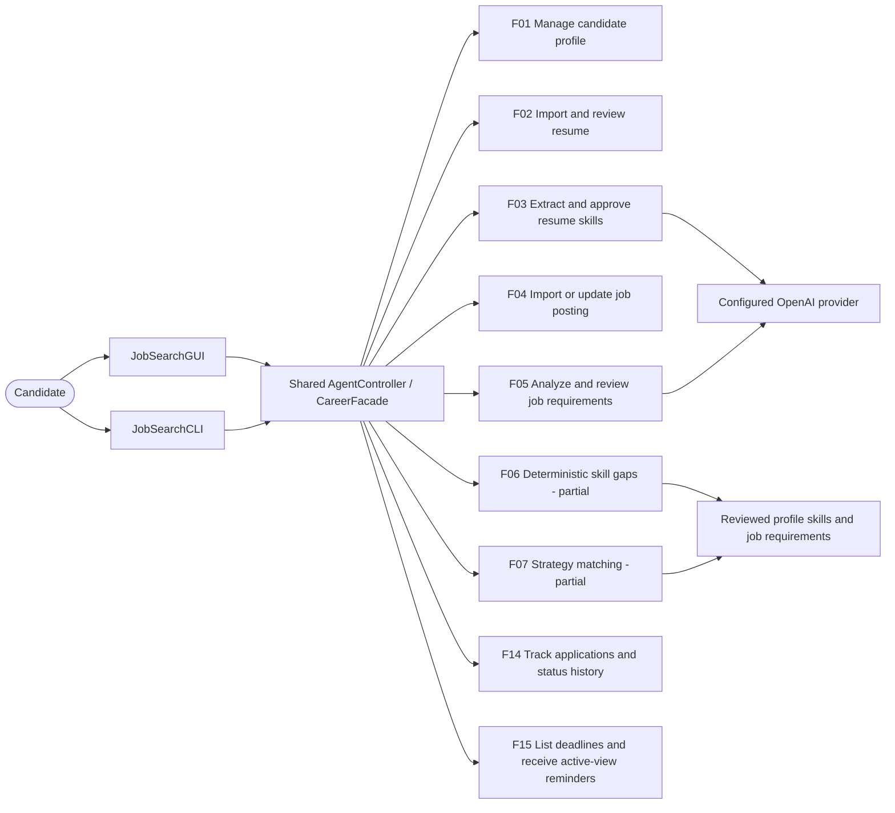

# Currently implemented interface workflows

This is the implemented subset, not a claim that all 17 Stage 1 use cases are done.
`docs/stage2-progress.md` accounts for every original feature and remaining work.
The Stage 1 use-case diagram remains the planned full-system scope.
