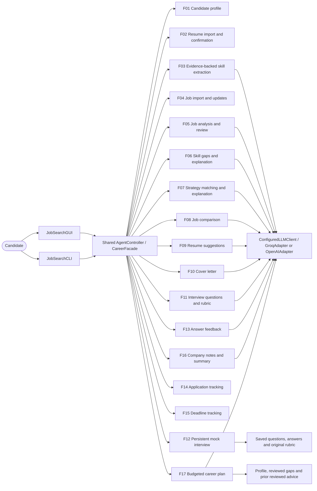

# Stage 2 implemented use cases — November 7

These are connected code workflows. AI paths have automated injected-provider
verification; live provider verification and all feature demonstration links are
still required before submission. The app does not send applications, letters,
messages or external notifications, or browse research websites automatically.
