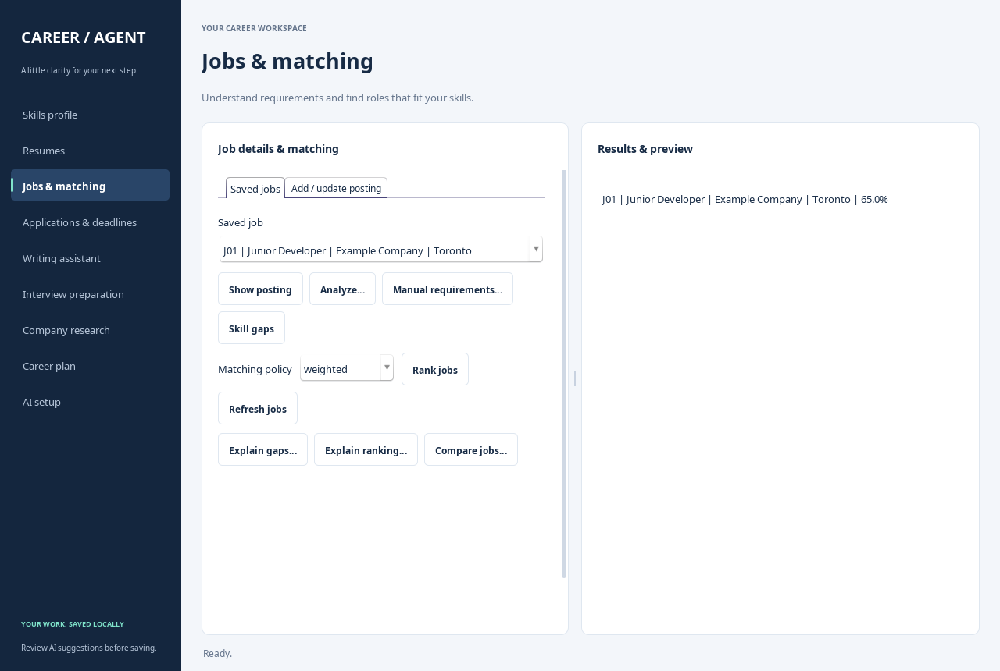

# AI Job Search and Career Agent — EECS3311

Java implementation of the 17 Stage 1 features, with Swing GUI and CLI sharing
`AgentController`, `CareerFacade`, local JSON records and feature-specific AI tasks.
Implemented patterns: **MVC, Facade, Adapter, Strategy and Observer**.

**Implementation status:** F01–F17 have connected implementations. A desktop-enabled
run passed all 61 tests. The user reported successful live Groq verification and
F03/F05/F06/F07 checks. Remaining live workflows, feature demonstration videos,
usage/cost figures and final report review are still pending before submission.
Injected model responses are used only in tests and are not live demonstrations.

## Build and launch

Requires Java 17+ and Maven 3.9+. Use a full desktop JDK for the GUI; a headless-only
Java installation supports the CLI and non-desktop tests. Internet access is needed
for the first Maven dependency download and live AI requests.

From the repository root, run one interface at a time:

```sh
mvn package
mvn exec:java
mvn exec:java "-Dexec.mainClass=ca.yorku.careeragent.ui.JobSearchGUI"
```

Both interfaces use local `data/`. The compiler runs in-process and targets Java 17
syntax/bytecode. Cloud verification uses Java 21. In the prepared cloud workspace:

```sh
/workspace/tools/apache-maven-3.9.9/bin/mvn -s /workspace/tools/maven-settings.xml package
/workspace/tools/apache-maven-3.9.9/bin/mvn -s /workspace/tools/maven-settings.xml exec:java
```

The original cloud JDK lacks desktop support. Native-window verification used an
Xorg dummy display and an official Adoptium Java 21 desktop JRE installed locally
under `work/`; neither is a project dependency on a normal desktop computer.

## Configure free API access locally

The default is **Groq**, with Groq-hosted `openai/gpt-oss-20b`. Groq offers a
quota-limited Free plan. An API key is required; use the Free plan for this project.
The model's `openai/` identifier identifies an open-weight model hosted by Groq;
requests use the Groq endpoint and Groq account.

1. Create a free Groq account and key at <https://console.groq.com/keys>.
2. Copy `.env.example` to `.env`: `cp .env.example .env` on macOS/Linux, or
   `Copy-Item .env.example .env` in PowerShell.
3. Set these values locally, replacing the key placeholder only in ignored `.env`:

```dotenv
LLM_PROVIDER=groq
GROQ_API_KEY=YOUR_LOCAL_API_KEY_HERE
GROQ_MODEL=openai/gpt-oss-20b
```

4. Run `ai status`, then `ai verify`, or use the GUI's AI setup tab. The verification
   makes a small actual provider call without candidate/job records.
5. Pace model requests and use short demo inputs to stay within free-plan limits.
   An HTTP 429 stops the task with recovery advice; check quota and wait before retrying.

Environment variables override `.env`; provider/configuration is reloaded per
request. There is no automatic fallback to another provider. Keys are kept in
separate settings, so a Groq request cannot use an OpenAI key. `.env`,
`config.local.json` and `data/` are ignored by Git. Keep keys out of chat, source,
reports and recordings. Manual workflows work without any API key.

Optional OpenAI support is retained: explicitly set `LLM_PROVIDER=openai`,
`OPENAI_API_KEY` and `OPENAI_MODEL` (default `gpt-4.1-mini`). OpenAI API billing is
separate from a ChatGPT subscription. HTTP 401 means a rejected key; 403 means
access restrictions; 413 means an oversized request; 429 means provider rate/quota
limits or account billing restrictions. Provider response bodies are not displayed.

Provider references checked November 7, 2026: [Groq Free-plan FAQ](https://community.groq.com/t/do-i-get-charged-for-anything-on-the-groq-free-plan/832),
[free-plan limits](https://console.groq.com/docs/rate-limits),
[model documentation](https://console.groq.com/docs/model/openai/gpt-oss-20b),
and [OpenAI-compatible API](https://console.groq.com/docs/openai).

## First run and GUI

Create a profile, then import a PDF/DOCX resume or paste text from a scanned resume.
Review and confirm the preview. Use the displayed saved IDs for subsequent tasks.
Import jobs and review requirements, using the model or explicit manual input.
The GUI sidebar covers Skills profile, Resumes, Jobs & matching, Applications & deadlines,
Writing assistant, Interview preparation, Company research, Career plan and AI setup.
Forms and results use separate cards; buttons reflow when the window is resized.
Jobs & matching separates **Saved jobs** from **Add / update posting** so the ranking
controls remain easy to reach. The built-in Swing theme needs no extra dependency.
Long requests run in background workers; generated writing opens an editable review
dialog. Original resumes are retained as separate immutable versions.



If your Windows copy came from Download ZIP, use the [GUI update steps](docs/windows-gui-update.md)
to update the two presentation files in your existing project folder.

## CLI feature guide

Type `help` for commands. Commands prompt for their inputs; multiline text ends
with a line containing only `.`. Use list commands to obtain actual saved IDs.
AI tasks request consent before sending relevant records to the configured provider.

| ID | Commands and behavior |
|---|---|
| F01 | `profile edit`, `profile show`: validated candidate details and approved skills |
| F02 | `resume import [path]`, `resume paste`, `resume list`, `resume show`: preview then confirm |
| F03 | `resume extract-skills`: numbered evidence-backed proposals; approve a subset |
| F04 | `job import`, `job list`, `job show`: a matching title/company updates the posting |
| F05 | `job analyze`, `job requirements`: reviewed skill/qualification/experience categories and evidence |
| F06 | `job gaps`, `job gaps explain`: matched/missing/uncertain skills and optional AI interpretation |
| F07 | `job match`, `job match explain`: required/weighted Strategy ranking and optional explanation |
| F08 | `job compare`: compare 2–4 distinct jobs, preserving unknown fields |
| F09 | `resume suggest`: editable suggestions with candidate evidence |
| F10 | `letter draft`: professional/warm/concise letter with generic greeting and evidence |
| F11 | `interview questions`, `interview question-sets`, `interview questions show`: 1–20 distinct questions with rubrics |
| F12 | `interview start`, `interview answer`, `interview skip`, `interview pause`, `interview resume`, `interview finish`, `interview show`, `interview list` |
| F13 | `interview feedback`: rubric-based strengths/weaknesses/improvements, 0–100 score and answer excerpt |
| F14 | `application add`, `application update`, `application list`: dates, transitions and status history |
| F15 | `deadlines list`, `deadlines check`: outstanding, overdue and unknown dates; active-view reminders |
| F16 | `company notes`, `company show`, `company summarize`: research, supplied URLs and reviewed summary |
| F17 | `career plan`: 1–4 target jobs, specific goal, weekly time and cost limits |

`document list`, `document show` and `document edit` reload reviewed letters,
suggestions, summaries and plans. At a preview choose `save`, `edit` or `cancel`.
Editing supplies the entire reviewed content. An interrupted CLI command cancels
pending reviews. Saved records survive restart.

## Behavior and limits

- Deterministic code owns skill sets, scores, status transitions, deadlines and
  budget totals. AI supplies reviewed suggestions and interpretations.
- Extracted skills/requirements must have literal supporting text. Writing and
  feedback validate source excerpts; human review is still required for semantic
  accuracy and fabricated qualifications. A quotation alone does not prove a claim.
- Provider failures preserve older records. Failed optional gap/ranking/comparison
  explanations retain deterministic results with a warning. Manual requirements,
  matching, tracking and parsing remain available without API access.
- Description changes invalidate reviewed job analysis. Source fingerprints reject
  stale document approval and remain stable across Java-process restarts.
- Weighted scores use 70% required and 30% preferred coverage when both categories
  exist; otherwise they use the available category. Required matching uses required
  coverage. Unanalyzed jobs have unknown compatibility in comparison.
- Interviews reuse saved question sets and retain their original job/rubric snapshot.
  Answers/skips save after every action; paused sessions must resume before answering.
  Finish requires every question answered or skipped. Skips receive no feedback.
- Company research uses user-supplied notes/URLs; the app does not browse or verify
  websites. Career plans cover one week, validate total hours/cost, and retrieve prior
  reviewed resume advice as advice memory. A cost budget of 0 requests free activities.
- Dates/reminders use America/Toronto. Untracked/SAVED jobs remain outstanding;
  submitted or closed applications receive no submission reminders. GUI checks every
  minute; CLI checks each prompt. Due dates within 0–7 days notify once per local
  day/process. Overdue/unknown dates are listed without notifications.
- AI context is limited to 60,000 characters; resume files to 20 MiB. No applications,
  letters, email or external notifications are sent automatically.
- Storage is single-candidate local JSON with atomic writes and no cross-process
  locking. Use one interface at a time and back up `data/` privately.

## Verification and submission records

`mvn test` runs 61 checks. With no desktop runtime/display, the native-window test is
skipped (60 pass, 1 skip). On November 7 a desktop-enabled run passed all 61 with no
failures/errors/skips. Coverage includes parsing, review/cancellation, malformed and
unsupported model data, HTTP/configuration redaction, persistence and separate-JVM
restart, gaps/ranking, interviews, notes/plans, budgets, dates, Observer lifecycle,
GUI saves/responsiveness, actual window/file-picker behavior and interrupted input.
Tests use injected responses/local HTTP, not paid model calls.

- [Implementation checkpoint and change record](docs/stage2-progress.md)
- [Report draft PDF](stage2-report.pdf) and [editable Word draft](stage2-report.docx)
- [Report source](docs/stage2-report-working-draft.md)
- [Weekly commit evidence](docs/weekly-commit-summary.md)
- [Demonstration recording checklist](docs/demonstration-guide.md)
- [Implemented class diagram](Diagrams/stage2_class_diagram.png)
- [Feature-specific sequences](Diagrams/stage2_ai_workflows.md)

The report is a draft until live verification, demonstration links and actual AI
usage/cost fields are completed. Original Stage 1 artifacts remain design references.
