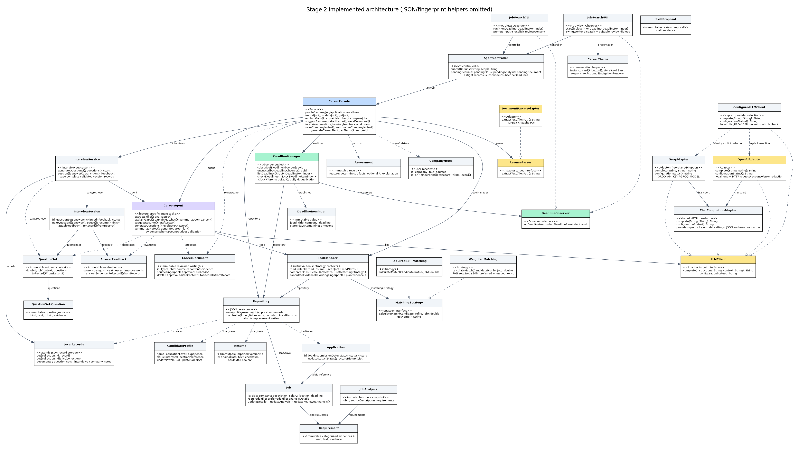
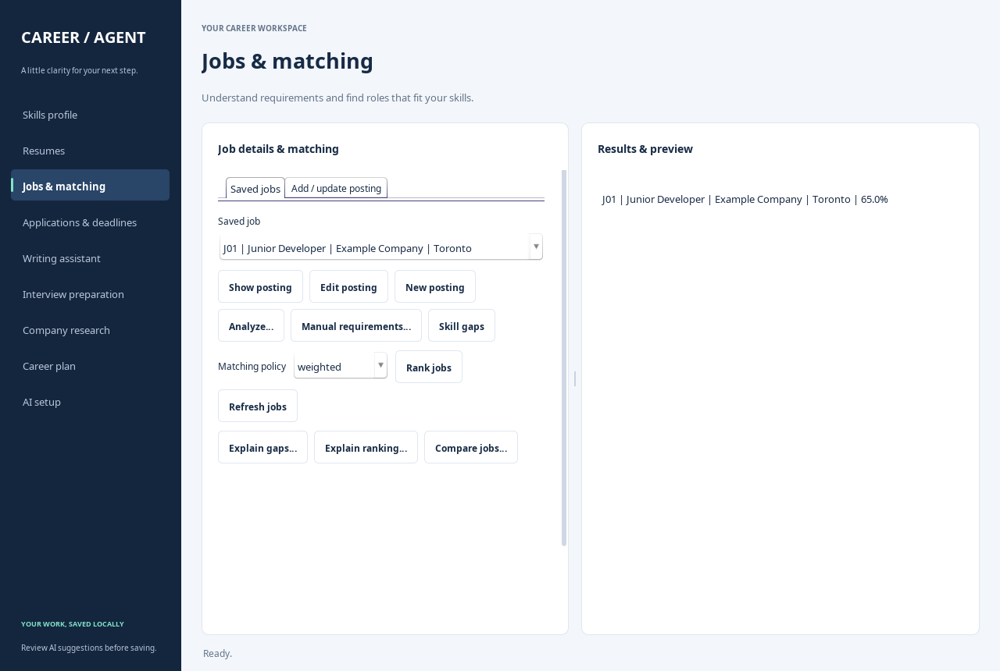

# Stage 2 Implementation Report — DRAFT

AI Job Search and Career Agent — EECS3311

**Draft status:** demonstration links, actual AI usage/cost figures, remaining live workflow checks and final review are incomplete. Groq connectivity and F03/F05/F06/F07 outputs are supported by supplied CLI transcripts and Windows screenshots. The weekly code-commit minimum is covered for each reporting period.

## 1. Project overview and implementation status

The application serves students, new graduates and career changers who need a single workspace for profiles, resumes, job comparison, application tracking, interview practice, research and career planning. Both Swing GUI and CLI route through AgentController and CareerFacade to the same local records. Source code now contains workflows for all 17 original Stage 1 features; deterministic behavior and injected-provider workflows were verified with 64 passing tests, including a real desktop window and file picker. Supplied CLI transcripts show successful live Groq verification and F03/F05/F06/F07 results with a private local Free-plan key. Other live feature checks remain pending.

ConfiguredLLMClient selects a concrete GroqAdapter by default (Groq-hosted openai/gpt-oss-20b) or an explicitly selected OpenAIAdapter (gpt-4.1-mini). Both use shared ChatCompletionAdapter HTTP translation behind provider-independent LLMClient. The Groq option provides quota-limited free access while retaining the provider-independent LLMClient boundary. Keys are provider-specific, and failures never trigger an automatic switch to a paid provider. The agent performs retrieval through ToolManager, task-specific generation, schema/evidence validation, review and persistence. It retrieves prior reviewed resume advice for career planning as durable advice memory. It is a bounded task agent, not an autonomous planner or unrestricted model-selected tool executor. Generated content never sends applications/messages or modifies the original resume automatically.

## 2. Feature-to-implementation mapping

All IDs below refer to the original Stage 1 feature with the same ID. “Implemented” describes connected source-code workflows, not a claim that every live feature check or the feature videos have been completed. The supplied transcripts and screenshots are separate from automated tests and recordings. Every demonstration entry is pending recording and an accessible direct link to its labeled segment.

### F01 — Candidate Profile Management

- Stage 1 reference: F01. Status: implemented; transcript-supported CLI creation and Windows GUI reload confirmed the saved demo profile.
- Mode: Deterministic.
- Participating classes/key methods: CareerFacade.updateProfile; CandidateProfile.updateProfile/updateSkills; Repository.save/loadProfile.
- Invocation: profile edit / Skills profile.
- Collaboration from input to output: Both views route candidate details through AgentController. The facade validates required name/education, normalizes skill sets and atomically saves the profile. Invalid entries leave the prior file intact.
- Design patterns: MVC, Facade.
- Demonstration link: **pending**.

### F02 — Resume Import

- Stage 1 reference: F02. Status: implemented; transcript-supported PDF preview/confirmation/save succeeded, and import without a profile was rejected. DOCX and other paths have automated coverage; recording remains pending.
- Mode: Deterministic.
- Participating classes/key methods: CareerFacade.previewResume/previewResumeText/importResume; ResumeParser; DocumentParserAdapter; Resume; Repository.
- Invocation: resume import / resume paste / Resumes.
- Collaboration from input to output: The parser Adapter extracts PDF/DOCX text. The facade snapshots the source, calculates its checksum and presents a preview; explicit confirmation saves an immutable version. Unsupported, corrupt, blank and encrypted files fail without replacing existing versions; pasted text supports scanned resumes. A newly saved resume is selected in the resume library and writing workspace; cancellation preserves the earlier selection.
- Design patterns: Adapter, MVC, Facade.
- Demonstration link: **pending**.

### F03 — Resume Skill Extraction

- Stage 1 reference: F03. Status: implemented; transcript-supported live Groq extraction, supporting quotations, approval of only JUnit and a subsequent persisted profile reload succeeded.
- Mode: AI with deterministic validation.
- Participating classes/key methods: CareerAgent.extractSkills; ToolManager.readProfile/readResume; SkillProposal; CareerFacade.approveSkills; AgentController.
- Invocation: resume extract-skills / Resumes.
- Collaboration from input to output: The task retrieves a saved resume and profile, calls LLMClient, validates source excerpts and full skill-token boundaries, removes duplicates and exposes numbered proposals. Selected skills merge with the current profile only after candidate approval.
- Design patterns: Adapter, Facade, MVC.
- Demonstration link: **pending**.

### F04 — Job Import

- Stage 1 reference: F04. Status: implemented; transcript-supported CLI import and Windows GUI retrieval of J01 succeeded.
- Mode: Deterministic.
- Participating classes/key methods: CareerFacade.importJob/updateJob; AgentController job.import/job.update; Job.updateDetails; Repository.findJobByTitleAndCompany/save.
- Invocation: job import / Jobs & matching.
- Collaboration from input to output: The controller parses posting fields and an optional date. New postings are created or deduplicated by title/company. Edit posting loads the selected record into the form; explicit edits use its saved ID, preserve linked applications and reject a title/company collision with another record. New posting clears edit mode. Description changes clear old requirements and evidence; metadata changes retain analysis. The saved record becomes selected across the job selectors.
- Design patterns: MVC, Facade.
- Demonstration link: **pending**.

### F05 — Job Description Analysis

- Stage 1 reference: F05. Status: implemented; transcript-supported live Groq analysis categorized Java/SQL as required and Git as preferred, with source quotations and explicit approval.
- Mode: AI with deterministic validation.
- Participating classes/key methods: CareerAgent.analyzeJob; ToolManager.readJob; JobAnalysis; Requirement; CareerFacade.approveJobAnalysis; Job.updateReviewedAnalysis.
- Invocation: job analyze / job requirements / Jobs & matching.
- Collaboration from input to output: This task separately retrieves a job description and validates its requirement schema, category and supporting excerpt. Required/preferred skills, qualifications, experience and uncertain statements are reviewed by number. A source snapshot prevents approval after the description changes. Manual reviewed requirements remain available.
- Design patterns: Adapter, Facade, MVC.
- Demonstration link: **pending**.

### F06 — Skill Gap Identification

- Stage 1 reference: F06. Status: implemented; transcript-supported comparison returned matched Java/missing SQL/no uncertain skills, and the live AI explanation preserved those facts.
- Mode: Hybrid.
- Participating classes/key methods: ToolManager.compareSkills; CareerFacade.identifyGaps/explainGaps; CareerAgent.explainGaps; Assessment.
- Invocation: job gaps / job gaps explain.
- Collaboration from input to output: Approved skills are compared with reviewed requirements to produce matched, missing and uncertain lists. An optional task retrieves those facts and asks for an evidence-cited interpretation. An invalid or unavailable model result produces a warning alongside the deterministic result.
- Design patterns: Strategy context, Adapter, Facade, MVC.
- Demonstration link: **pending**.

### F07 — Job Matching

- Stage 1 reference: F07. Status: implemented; transcript-supported Windows GUI ranking returned weighted 65% and required 50%, and the live AI explanation preserved the required score and gaps.
- Mode: Hybrid.
- Participating classes/key methods: MatchingStrategy; WeightedMatching; RequiredSkillMatching; ToolManager.calculateMatch/setMatchingStrategy; CareerFacade.matchJobs/explainMatches; CareerAgent.explainMatches.
- Invocation: job match / job match explain.
- Collaboration from input to output: A selected Strategy computes scores from approved skills, sorts descending and breaks ties by job ID. Weighted matching allocates 70% to required and 30% to preferred coverage when both exist; required matching uses required coverage. An optional task interprets the fixed ranking and gaps without controlling numeric results.
- Design patterns: Strategy, Adapter, Facade, MVC.
- Demonstration link: **pending**.

### F08 — Job Comparison

- Stage 1 reference: F08. Status: implemented in code; live AI check pending where applicable.
- Mode: Hybrid.
- Participating classes/key methods: CareerFacade.compareJobs; CareerAgent.summarizeComparison; ToolManager; Assessment.
- Invocation: job compare / Compare jobs.
- Collaboration from input to output: The facade validates two to four distinct selections, retrieves posting details and computes compatibility using the selected policy. It preserves unknown salary/location/deadline and unanalysed compatibility. A separate AI interpretation cites supplied comparison facts; failure preserves the table.
- Design patterns: Strategy, Adapter, Facade, MVC.
- Demonstration link: **pending**.

### F09 — Customized Resume Suggestions

- Stage 1 reference: F09. Status: implemented in code; live AI check pending where applicable.
- Mode: AI with review.
- Participating classes/key methods: CareerAgent.suggestResume; ToolManager.candidateEvidence/writingFingerprint; CareerDocument; CareerFacade.saveDocument; LocalRecords.
- Invocation: resume suggest / Writing assistant.
- Collaboration from input to output: The task retrieves the original resume, approved profile and reviewed job requirements. Each proposed suggestion needs a verbatim candidate excerpt. The candidate edits and approves a separate document; changed source records reject stale approval. Earlier reviewed advice is later retrieved as career-planning memory.
- Design patterns: Adapter, Facade, MVC.
- Demonstration link: **pending**.

### F10 — Cover Letter Drafting

- Stage 1 reference: F10. Status: implemented in code; live AI check pending where applicable.
- Mode: AI with review.
- Participating classes/key methods: CareerAgent.draftLetter; CareerDocument; CareerFacade.draftLetter/saveDocument/getDocument/listDocuments; LocalRecords.
- Invocation: letter draft / Writing assistant.
- Collaboration from input to output: The task validates a professional/warm/concise tone and retrieves candidate evidence and the selected posting. It validates two to six paragraphs and candidate quotations; the application supplies a generic hiring-team greeting and candidate signature. The editable letter is saved after review; provider failure preserves previously saved drafts.
- Design patterns: Adapter, Facade, MVC.
- Demonstration link: **pending**.

### F11 — Interview Question Generation

- Stage 1 reference: F11. Status: implemented in code; live AI check pending where applicable.
- Mode: AI with validation.
- Participating classes/key methods: CareerAgent.generateQuestions; QuestionSet/Question; InterviewService.generateQuestions; LocalRecords.
- Invocation: interview questions / Interview preparation.
- Collaboration from input to output: The task retrieves reviewed job requirements, requests an exact count of 1–20 questions and validates count, duplicate wording, technical/behavioural categories, rubrics and source quotations. With two or more questions both categories are required. Valid question sets are saved with their original job context and become the selected question set in the GUI.
- Design patterns: Adapter, Facade, MVC.
- Demonstration link: **pending**.

### F12 — Mock Interview

- Stage 1 reference: F12. Status: implemented in code; live AI check pending where applicable.
- Mode: Hybrid.
- Participating classes/key methods: InterviewSession.answer/pause/resume/finish; InterviewService.start/answer/transition; LocalRecords.
- Invocation: interview start / answer / skip / pause / resume / finish.
- Collaboration from input to output: A session reuses a saved question set and retains its original job/rubric snapshot. Each answer or explicit skip is saved. A paused session must resume before answering; finishing requires every question to be answered or skipped. State and next-question progress survive restart. A newly started session becomes selected automatically; ordinary refreshes preserve an explicit selection.
- Design patterns: Facade, MVC.
- Demonstration link: **pending**.

### F13 — Interview Answer Feedback

- Stage 1 reference: F13. Status: implemented in code; live AI check pending where applicable.
- Mode: AI with validation.
- Participating classes/key methods: CareerAgent.evaluateAnswers; AnswerFeedback; InterviewSession.attachFeedback; InterviewService.feedback.
- Invocation: interview feedback / Interview preparation.
- Collaboration from input to output: The task retrieves the session's submitted answers, original questions, rubrics and job context. It requires exactly one feedback entry per answered question, excludes skips, validates integer scores of 0–100, structured strengths/weaknesses/improvements and an exact answer excerpt. The complete response is validated before replacement of saved feedback.
- Design patterns: Adapter, Facade, MVC.
- Demonstration link: **pending**.

### F14 — Application Tracking

- Stage 1 reference: F14. Status: implemented in code; live AI check pending where applicable.
- Mode: Deterministic.
- Participating classes/key methods: CareerFacade.trackApplication/updateApplicationStatus; Application.updateStatus/restoreHistory; Repository.
- Invocation: application add / application update / Applications & deadlines.
- Collaboration from input to output: Tracking opens or creates the selected job's application and validates statuses, allowed transitions and nonfuture submission/saved dates in Toronto time. Status history persists. Duplicate applications reuse existing records; invalid transitions or dates are rejected.
- Design patterns: MVC, Facade.
- Demonstration link: **pending**.

### F15 — Deadline Tracking

- Stage 1 reference: F15. Status: implemented in code; live AI check pending where applicable.
- Mode: Deterministic.
- Participating classes/key methods: DeadlineManager.listDeadlines/checkDeadlines/subscribe/unsubscribe; DeadlineObserver.onDeadline; DeadlineReminder; GUI Timer; CLI.
- Invocation: deadlines list / deadlines check.
- Collaboration from input to output: The Observer subject uses an injectable Clock with Toronto default. It lists outstanding jobs as overdue, today, upcoming or unknown; submitted/closed applications are suppressed. Due dates within 0–7 days notify subscribed views once per local day/process. GUI checks every minute; CLI checks at each prompt. Views unsubscribe on close.
- Design patterns: Observer, MVC, Facade.
- Demonstration link: **pending**.

### F16 — Company Research Notes

- Stage 1 reference: F16. Status: implemented in code; live AI check pending where applicable.
- Mode: Hybrid.
- Participating classes/key methods: CompanyNotes; CareerFacade.saveCompanyNotes/getCompanyNotes; ToolManager.readNotes; CareerAgent.summarizeNotes; CareerDocument; LocalRecords.
- Invocation: company notes / company show / company summarize.
- Collaboration from input to output: User-entered research and optional HTTP(S) source URLs are stored by company. A separate task retrieves those notes, validates quoted evidence and citations against supplied URLs and returns an editable summary. It does not browse websites or verify the source contents. Changed notes invalidate stale summary approval; manual research persists despite AI failure.
- Design patterns: Adapter, Facade, MVC.
- Demonstration link: **pending**.

### F17 — Career Development Plan

- Stage 1 reference: F17. Status: implemented in code; live AI check pending where applicable.
- Mode: AI with deterministic constraints and review.
- Participating classes/key methods: ToolManager.planEvidence; CareerAgent.generateCareerPlan; CareerDocument; CareerFacade.generateCareerPlan/saveDocument; LocalRecords.
- Invocation: career plan / Career plan.
- Collaboration from input to output: The task retrieves profile, reviewed gaps for 1–4 selected jobs and up to five prior reviewed resume suggestions as advice memory. It validates a specific goal, weekly hours and cost budget; generated activities must reference known gaps, have positive study time and fit total time/cost limits. The candidate reviews a separate one-week plan; source changes invalidate stale approval.
- Design patterns: Adapter, Facade, MVC.
- Demonstration link: **pending**.

## 3. Implemented design patterns

### MVC

JobSearchGUI and JobSearchCLI are views. AgentController routes action/input maps and holds pending review snapshots; CareerFacade and domain classes own workflow rules; Repository/LocalRecords persist state. This prevents either UI from implementing independent validation/provider/persistence workflows. Key boundary: submitRequest(action,input). Native GUI requests run in SwingWorker while controls prevent overlapping writes. CareerTheme provides styling and responsive action layout; sidebar navigation switches between nine workspaces without moving domain rules into the view.

### Facade

CareerFacade coordinates CareerAgent, ToolManager, ResumeParser, DeadlineManager, InterviewService and Repository. Public feature methods expose meaningful operations such as approveJobAnalysis, saveDocument, startInterview and generateCareerPlan, rather than requiring a view to orchestrate subsystems. This matches the Stage 1 architectural role; explicit typed task values replace planned generic Request/Result objects.

### Adapter

LLMClient is the target interface. GroqAdapter and OpenAIAdapter are concrete provider Adapters, sharing ChatCompletionAdapter for compatible HTTP translation, completion validation and error redaction. ConfiguredLLMClient reads the explicit provider choice locally for each request. The current default is Groq Free-plan access; optional OpenAI support is retained. ResumeParser is a second target with DocumentParserAdapter wrapping PDFBox/Apache POI via extractText(Path). Both adapter families count as one distinct pattern. Provider/parsing libraries do not enter UI workflows.

### Strategy

MatchingStrategy defines calculateMatch(profile,job) and getName. WeightedMatching and RequiredSkillMatching are interchangeable policies. ToolManager is the context, and CareerFacade selects a policy and ranks results. Numeric matching stays deterministic even when optional model explanations fail. This matches the Stage 1 purpose.

### Observer

DeadlineManager is the subject, maintaining subscribed DeadlineObserver instances. Views implement onDeadline(DeadlineReminder), register while active and unsubscribe on close. checkDeadlines retrieves current records and Clock-based Toronto dates; the subject does not import either UI. Injected Clock supports tests at local-day and seven-day boundaries. This refines the originally abstract notification signatures into concrete operations.

The implemented UML includes the writing, interview, research, planning, storage and presentation classes. Concrete Adapter/Observer operations and role labels are used; feature-specific sequences show retrieval, validation, failure and review paths. Original Stage 1 artifacts remain historical planned-design references.

The [full-resolution class diagram](https://github.com/syedaafatima/EECS3311-Project/blob/main/Diagrams/stage2_class_diagram.png), [vector diagram](https://github.com/syedaafatima/EECS3311-Project/blob/main/Diagrams/stage2_class_diagram.svg), [feature sequences](https://github.com/syedaafatima/EECS3311-Project/blob/main/Diagrams/stage2_ai_workflows.md) and [use cases](https://github.com/syedaafatima/EECS3311-Project/blob/main/Diagrams/stage2_use_cases.md) accompany this report.

## 4. Changes and rationale

### Generic executeTask/executeTool loop

- Original design: Generic executeTask/executeTool loop.
- Implemented change: Separate F03/F05/F06/F07/F08/F09/F10/F11/F13/F16/F17 methods with task-specific retrieval, schemas, evidence and failure branches.
- Reason: Feature-specific retrieval and validation make each AI workflow traceable; bounded calls make behavior testable.
- Impact: CareerAgent, ToolManager, CareerFacade; no unimplemented generic loop is claimed as complete functionality.

### Resume/profile ownership and planned Request/Result transport types

- Original design: Resume/profile ownership and planned Request/Result transport types.
- Implemented change: Single local profile, independent resume/job/application records, action/input maps and immutable typed task results.
- Reason: Keep both views consistent while supporting durable single-candidate workflows.
- Impact: AgentController review state, Repository and new Assessment/JobAnalysis/SkillProposal/CareerDocument/QuestionSet/AnswerFeedback/CompanyNotes value types.

### Loose job analysis output

- Original design: Loose job analysis output.
- Implemented change: Categorized reviewed requirements with verbatim evidence and source snapshot.
- Reason: Prevent ungrounded/stale requirements from affecting scoring.
- Impact: JobAnalysis, Requirement, Job.updateReviewedAnalysis; description changes clear old analysis.

### Abstract parser/provider operations

- Original design: Abstract parser/provider operations.
- Implemented change: ResumeParser.extractText(Path): String; LLMClient.complete(String,String): String.
- Reason: Make concrete Adapter operations precise.
- Impact: DocumentParserAdapter wraps PDFBox/POI; OpenAIAdapter wraps chat-completions HTTP and local configuration.

### Abstract deadline notification of an Application

- Original design: Abstract deadline notification of an Application.
- Implemented change: subscribe/unsubscribe/checkDeadlines/listDeadlines with onDeadline(DeadlineReminder), injectable Clock.
- Reason: Separate deadline rules from either UI and make timezone boundaries testable.
- Impact: Observer subject DeadlineManager; GUI Timer/CLI prompt checks; no external notification service.

### Directly edited resume/letter output

- Original design: Directly edited resume/letter output.
- Implemented change: Reviewed CareerDocument records separate from original resumes, with source fingerprints and evidence.
- Reason: Preserve originals and require user review.
- Impact: F09/F10/F16/F17 share document review/persistence while retaining feature-specific generation and validation.

### Generate questions for every new mock session

- Original design: Generate questions for every new mock session.
- Implemented change: F11 saves reusable QuestionSet records; F12 starts from a selected set and snapshots it.
- Reason: Avoid paying for regeneration and preserve the original evaluation rubric after job edits.
- Impact: InterviewService, InterviewSession; answers/skips/status/feedback are durable.

### General career planning budget concept

- Original design: General career planning budget concept.
- Implemented change: Explicit one-week time and cost limits; validate actual generated totals.
- Reason: Reject over-time/over-cost recommendations rather than only suggesting review.
- Impact: F17 activity schema and decimal total checks; cost budget 0 requests free activities; prior reviewed advice is retrieved as memory.

### R1/R2 relation identifiers

- Original design: R1/R2 relation identifiers.
- Implemented change: Role names and no redundant labels on realization edges; updated implemented-system diagrams.
- Reason: Role labels clarify relationships, and concrete operations make the Adapter and Observer contracts precise.
- Impact: Refined Stage 1 export and separate current Stage 2 diagrams; preserve planned diagrams as historical references.

### Direct JSON updates and unstable collection fingerprints

- Original design: Direct JSON updates and unstable collection fingerprints.
- Implemented change: Atomic replacement saves, canonical ordered source text, separate-JVM regression verification.
- Reason: Protect earlier records on save failure and keep approved documents editable after restart.
- Impact: Repository/LocalRecords, SourceFingerprint, ToolManager; bracket-containing/long array values round-trip.

### Planned OpenAI-only integration → configurable free-provider default

- Original design: OpenAIAdapter with GPT-4.1 mini as the proposed runtime provider/model.
- Implemented change: GroqAdapter and ConfiguredLLMClient add Groq-hosted `openai/gpt-oss-20b` as the default; OpenAIAdapter remains an explicit optional selection. ChatCompletionAdapter shares compatible HTTP handling, with separate key/model namespaces and no automatic provider fallback.
- Reason: Groq's documented Free plan reduces runtime cost, and its JSON-capable production model fits the existing task schemas. The Stage 2 instructions permit a cheap/free model and documented provider changes.
- Impact: all AI features use the same LLMClient boundary; per-feature retrieval/validation/review remains unchanged. Consent text is provider-neutral. The AI setup tab, CLI, safe example configuration, HTTP tests and model/provider report mapping were updated.
- Provider references: [Groq Free-plan FAQ](https://community.groq.com/t/do-i-get-charged-for-anything-on-the-groq-free-plan/832), [rate limits](https://console.groq.com/docs/rate-limits), [model](https://console.groq.com/docs/model/openai/gpt-oss-20b), [API compatibility](https://console.groq.com/docs/openai). Availability and quotas are account/provider controlled. Supplied CLI output confirms a successful live connectivity check.

### Desktop layout refinement

- Original design: shared Swing GUI with nine top tabs and equal-width button grids.
- Implemented change: a persistent sidebar, consistent built-in Swing theme, separate form/result cards, readable multiline fields, buttons that reflow at smaller widths, a progress indicator and separate saved-job/posting-entry views.
- Reason: Smaller windows caused wrapped navigation, clipped action labels and cramped fields. Sidebar navigation and responsive controls improve readability and access to saved-job tools.
- Impact: JobSearchGUI and new presentation helper CareerTheme. Controller requests, explicit AI consent/review and local persistence retain their roles; no new design pattern or dependency is counted. Native desktop checks exercise navigation, file-picker cancellation, readable controls at two sizes and the visible deterministic ranking. An existing Period 1 test fixture was corrected to use Toronto dates consistently with application validation.

### Saved-record selection and posting identity

- Original design: selector refreshes always retained the old selection, and posting updates were identified only by title/company.
- Implemented change: a single newly saved resume, job, question set or session is selected automatically; ordinary refreshes and cancelled imports preserve the existing choice. Edit posting loads stored values and submits an explicit job ID. New posting clears the editing state. Duplicate identities are rejected without changing either saved record.
- Reason: prevent actions from accidentally using an older record and allow title/company edits while retaining application references.
- Impact: JobSearchGUI.refreshSelector and posting editor, AgentController job.update/getJob, CareerFacade.updateJob and GUI persistence regression checks. Existing MVC/Facade boundaries and duplicate-import behavior remain in use; no new feature or design pattern is counted.

## 5. AI tools and collaboration log

Development tool: OpenAI Codex, GPT-6-based assistant; exact deployed model identifier is not exposed to this workspace. It assisted with implementation, code review, tests, fault diagnosis, design mapping and report drafting. The application runtime now defaults to Groq-hosted openai/gpt-oss-20b through GroqAdapter; optional OpenAI remains configurable through OpenAIAdapter. These runtime models are separate from the development-tool model.

Representative interactions:

- Resume import: AI assistance developed PDF/DOCX parsing through the Adapter pattern, preview/confirmation, immutable resume versions and error handling.
- Evidence-backed workflows: implementation prompts emphasized exact source quotations, selective approval and invalidation after source edits. These constraints shaped F03 skill extraction and F05 job analysis.
- Assessments and writing: implementation work connected F06–F08 explanations/comparison and F09–F10 editable documents while preserving deterministic scores and original resumes.
- Interview preparation: AI assistance developed F11 question/rubric generation, F12 persistent sessions and F13 answer-grounded feedback, including skips and pause/resume behavior.
- Research and planning: implementation work connected F16 supplied-note summaries and F17 plans constrained by weekly hours, cost and reviewed skill gaps; prior approved advice is retrieved as memory.
- GUI workflow review: assistance connected automatic record selection, explicit ID-based posting edits and regression checks for cancellation, duplicate rejection and application references.
- Review and integration: assistance covered source fingerprints across restarts, atomic persistence, validation, API configuration, provider error redaction, desktop layout refinement and report traceability.

Human responsibilities include understanding and reviewing generated code, checking real provider outputs, recording feature demonstrations and reviewing the final submission. Exact development-tool token use and monetary cost remain **pending actual platform usage/billing records**. Runtime verification and demonstration usage/cost figures are also pending provider records. No estimated totals are presented as measured usage.

## 6. Development and verification summary

### Weekly commits (Toronto local periods)

At least five distinct substantive development changes are recorded for each completed period; additional code changes are included below. Duplicated imports/merge copies and README-only updates are not used to inflate the counts.

#### Period 1

- [a500b89](https://github.com/syedaafatima/EECS3311-Project/commit/a500b89) — Core domain models and JSON repository.
- [4ac8717](https://github.com/syedaafatima/EECS3311-Project/commit/4ac8717) — F01 candidate profile through MVC and Facade.
- [0945542](https://github.com/syedaafatima/EECS3311-Project/commit/0945542) — F04 job import and duplicate updates.
- [1509555](https://github.com/syedaafatima/EECS3311-Project/commit/1509555) — F14 application tracking/history.
- [c9cfb2d](https://github.com/syedaafatima/EECS3311-Project/commit/c9cfb2d) — Strategy matching and Period 1 verification.

#### Period 2

- [80fbb8e](https://github.com/syedaafatima/EECS3311-Project/commit/80fbb8e) — F02 PDF/DOCX resume import and verification.
- [5d74f5d](https://github.com/syedaafatima/EECS3311-Project/commit/5d74f5d) — F03 reviewed resume skill extraction.
- [0c92787](https://github.com/syedaafatima/EECS3311-Project/commit/0c92787) — F05 reviewed job analysis and invalidation.
- [df2882e](https://github.com/syedaafatima/EECS3311-Project/commit/df2882e) — F15 deadline Observer.
- [12fc14a](https://github.com/syedaafatima/EECS3311-Project/commit/12fc14a) — Shared Swing GUI and refined UML/workflows.

#### Period 3

- [a73d1ac](https://github.com/syedaafatima/EECS3311-Project/commit/a73d1acb612ee4f6960ba6d7ad0224cae2565010) — Complete F06-F08 AI explanations and deterministic job comparison.
- [bbe8de8](https://github.com/syedaafatima/EECS3311-Project/commit/bbe8de8eaee101f27fc26d4357b56f570f55a25f) — Implement F09-F10 editable evidence-backed resume and cover-letter drafts.
- [7bd7015](https://github.com/syedaafatima/EECS3311-Project/commit/7bd701565a6de56f4ce1aa3fe2bc185f26c8a927) — Implement F11-F13 interview questions, persistent sessions and rubric feedback.
- [579f50a](https://github.com/syedaafatima/EECS3311-Project/commit/579f50ab29664dc0f949ea0aeadf20bbcbec7c5a) — Implement F16-F17 source-cited company research and budgeted career plans.
- [0f2b00a](https://github.com/syedaafatima/EECS3311-Project/commit/0f2b00a3611cc0ad830ab2b7f36b90ebf51366fa) — Harden restart-safe drafts, persistence and API setup with desktop verification.

The listed commits cover the minimum of five distinct implementation/test changes in each reporting period, with additional substantive changes also recorded. Repository history and recorded push evidence support the period assignments. The Period 1 core-model entry links to the actual implementation commit. An additional tracker-history fix is recorded in [6979590](https://github.com/syedaafatima/EECS3311-Project/commit/6979590), configurable Groq support in [8d52ea2](https://github.com/syedaafatima/EECS3311-Project/commit/8d52ea2), and the desktop layout refinement in [9b59fb2](https://github.com/syedaafatima/EECS3311-Project/commit/9b59fb2d40064fb581b5b0e82205e7daf56d49a4). A further workflow refinement is recorded in [9fa26eb](https://github.com/syedaafatima/EECS3311-Project/commit/9fa26eb2fcfb1ef0e22882af2fac89c2d9935fbd); it is separate from the selected reporting-period commits. Report-only and formatting-only changes are excluded. Additional commits in one period do not compensate for a deficient period.

### Verification

The recorded desktop-enabled verification run passed 64 tests with zero failures/errors/skips using a desktop-capable Java 21 test runtime and virtual X display. The suite covers PDF/DOCX parsing; preview/confirmation/cancellation; long text, Unicode and control characters; malformed and unsupported model evidence; HTTP contract/configuration precedence and credential redaction; original resume preservation; stale-source rejection; budget checks; exact interview question counts and duplicate detection; session pause/resume/skip/finish and feedback validation; deadline timezone/Observer lifecycle; GUI forms, background responsiveness, actual window and native file-picker cancellation; a separate JVM editing reviewed records; invalid future application dates; and interrupted document editing.

Tests use injected model responses/local HTTP endpoints. They do not establish live Groq/OpenAI account access or prove the truth/quality of every model-generated sentence. Separately, supplied Windows CLI output reports: "Live LLM verification succeeded. The configured model returned the expected JSON response." The preceding `ai status` output selected Groq and confirmed a locally configured key with its value hidden. PowerShell output confirmed Temurin JDK 21.0.13 and Maven 3.10.0. This transcript-supported connectivity check was not independently run in the cloud workspace and does not replace remaining feature-level live checks, recordings or human review. Follow-up user transcripts/screenshots confirmed the F03/F05/F06/F07 results described above; other live feature paths remain pending. Full Stage 3 deterministic/KUMA requirements are outside this Stage 2 checkpoint.

A separate source-only checkout compiled all application and test sources and packaged successfully. The refreshed desktop was also checked at 900×650 and 1280×860: all nine workspaces were accessible, multiline fields retained readable height, long button labels fit, the native file picker cancelled correctly and the actual Rank jobs action displayed the expected 65% weighted result for fictional test data.

Additional GUI regression checks confirm that newly saved records become selected, explicit choices survive ordinary refreshes and cancelled imports, renamed postings retain their IDs/application links, description edits invalidate old analysis, identity collisions leave records intact and New posting clears editing state.

Important corrected defects: long-text JSON regex stack risk; interrupted input retaining stale review state; edited posting descriptions retaining old requirements; unordered collection iteration changing source fingerprints after restart; bracket-containing array values truncating; direct record writes risking partial content; unchecked future application dates; provider error bodies risking disclosure; saved tracker history not appearing in interface output; and native GUI prerequisites missing from the original cloud JRE.

### Remaining limitations and finalization work

- Complete the remaining AI workflows against the real model. Supplied output already supports local key setup, ai verify and F03/F05/F06/F07 checks. Allow time between requests and use short demonstration inputs to fit free-tier quotas.
- Human-review source evidence and qualifications; quotation checks do not guarantee semantic truth.
- Single-candidate local JSON storage; run one interface at a time because there is no cross-process file locking.
- No web browsing/source verification, external application sending or OS/email notifications.
- AI context limit is 60,000 characters. Date reminders use Toronto; interviews use captured original job/rubric context.
- Complete all videos and accessible links, exact AI usage/cost figures and final PDF/human review before submission. Updated diagrams and the five-code-commit Period 3 upload are now present.

## 7. Demonstration index

Every feature requires an actual running demonstration; screenshots, tests and this report are not substitutes. Use both GUI and CLI across the recordings. Each segment must identify the feature ID, input, output, AI involvement and a relevant error/alternative case. API keys must remain hidden. Demonstration links are pending for all 17 features; no fabricated URLs are supplied.

- F01 Candidate Profile Management: profile edit / Skills profile. **Demonstration link pending.**
- F02 Resume Import: resume import / resume paste / Resumes. **Demonstration link pending.**
- F03 Resume Skill Extraction: resume extract-skills / Resumes. **Demonstration link pending.**
- F04 Job Import: job import / Jobs & matching. **Demonstration link pending.**
- F05 Job Description Analysis: job analyze / job requirements / Jobs & matching. **Demonstration link pending.**
- F06 Skill Gap Identification: job gaps / job gaps explain. **Demonstration link pending.**
- F07 Job Matching: job match / job match explain. **Demonstration link pending.**
- F08 Job Comparison: job compare / Compare jobs. **Demonstration link pending.**
- F09 Customized Resume Suggestions: resume suggest / Writing assistant. **Demonstration link pending.**
- F10 Cover Letter Drafting: letter draft / Writing assistant. **Demonstration link pending.**
- F11 Interview Question Generation: interview questions / Interview preparation. **Demonstration link pending.**
- F12 Mock Interview: interview start / answer / skip / pause / resume / finish. **Demonstration link pending.**
- F13 Interview Answer Feedback: interview feedback / Interview preparation. **Demonstration link pending.**
- F14 Application Tracking: application add / application update / Applications & deadlines. **Demonstration link pending.**
- F15 Deadline Tracking: deadlines list / deadlines check. **Demonstration link pending.**
- F16 Company Research Notes: company notes / company show / company summarize. **Demonstration link pending.**
- F17 Career Development Plan: career plan / Career plan. **Demonstration link pending.**

## Appendix A. Source-file index

All Java source paths are under `src/main/java/ca/yorku/careeragent/`. Each class referenced above is implemented in its same-named Java file in the package below. This index ties feature/class names to actual files rather than implying unconnected design-only classes.

- `ui/`: `JobSearchCLI.java`, `JobSearchGUI.java`, `CareerTheme.java`.
- `controller/`: `AgentController.java`.
- `service/`: `CareerAgent.java`, `CareerFacade.java`, `InterviewService.java`, `ToolManager.java`.
- `domain/`: `AnswerFeedback.java`, `Application.java`, `Assessment.java`, `CandidateProfile.java`, `CareerDocument.java`, `CompanyNotes.java`, `InterviewSession.java`, `Job.java`, `JobAnalysis.java`, `QuestionSet.java`, `Requirement.java`, `Resume.java`, `SkillProposal.java`, `SourceFingerprint.java`.
- `persistence/`: `JsonSupport.java`, `LocalRecords.java`, `Repository.java`.
- `parser/`: `DocumentParserAdapter.java`, `ResumeParser.java`.
- `llm/`: `ChatCompletionAdapter.java`, `ConfiguredLLMClient.java`, `GroqAdapter.java`, `Json.java`, `LLMClient.java`, `OpenAIAdapter.java`.
- `strategy/`: `MatchingStrategy.java`, `RequiredSkillMatching.java`, `WeightedMatching.java`.
- `deadline/`: `DeadlineManager.java`, `DeadlineObserver.java`, `DeadlineReminder.java`.

## Appendix B. Reproduction and desktop verification

Normal desktop prerequisites: full Java 17+ JDK, Maven 3.9+, local provider API key for model tasks (Groq Free plan by default). Run `mvn package`, then `mvn exec:java` for the CLI or `mvn exec:java "-Dexec.mainClass=ca.yorku.careeragent.ui.JobSearchGUI"` for Swing. `ai status` reports configuration without printing the key; `ai verify` performs a small actual model call with no personal records, once a key is configured. The API setup section of README explains free Groq configuration and optional OpenAI configuration.

The cloud's original Java runtime is headless-only. Native checks used a locally installed official Adoptium Java 21 desktop JRE and a virtual Xorg dummy display. Standard headless builds skip the one native-window check; desktop-enabled verification runs it. Local/private configuration and data are ignored by Git. Safe fictional sample files are in `examples/`.

No live-key value, private candidate data or invented demonstration links are included in this draft.
