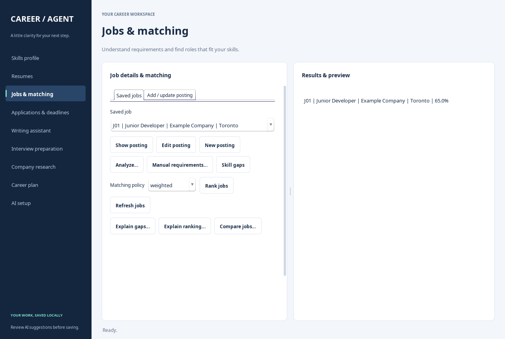

# Update the desktop app on Windows

These steps are for an existing project downloaded using GitHub's **Download ZIP**.
The update copies the matching presentation, controller and facade files into that project. Keep using
your current project directory so its private configuration and saved demo data
remain available.

1. Close the Career Agent window and wait for the normal `PS ...>` PowerShell prompt.
2. Make sure PowerShell is in your existing project folder, containing `pom.xml`.
3. Paste and run this whole block:

```powershell
$updateRoot = ".\src\main\java\ca\yorku\careeragent"
$updateSource = "https://raw.githubusercontent.com/syedaafatima/EECS3311-Project/9fa26eb2fcfb1ef0e22882af2fac89c2d9935fbd/src/main/java/ca/yorku/careeragent"
$updateFiles = @("ui/CareerTheme.java", "ui/JobSearchGUI.java", "controller/AgentController.java", "service/CareerFacade.java")
foreach ($updateFile in $updateFiles) {
    Invoke-WebRequest "$updateSource/$updateFile" -OutFile (Join-Path $updateRoot $updateFile) -ErrorAction Stop
}
```

4. Compile and launch the updated app:

```powershell
mvn compile exec:java "-Dexec.mainClass=ca.yorku.careeragent.ui.JobSearchGUI"
```

Use the sidebar to navigate. In **Jobs & matching → Saved jobs**, choose **Edit posting**
to load the selected job into the form. Saving keeps its job ID and application
references, including after title/company edits. A conflicting title/company is
rejected. **New posting** or **Clear / new posting** starts a blank editor.

Newly saved resumes, jobs, question sets and interview sessions become selected
automatically. Routine refreshes preserve explicit selections.



All source URLs are pinned to the same tested revision. Copy all four files together.
The built-in Swing theme adds no dependency. Full desktop-enabled verification passed
64 checks, including native navigation, file-picker cancellation, resizing, the
displayed ranking, selection persistence and posting-edit integrity.
